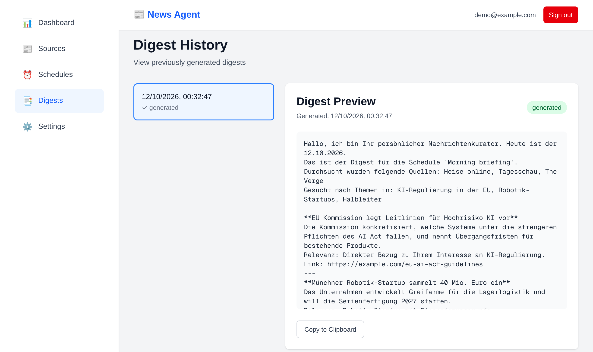
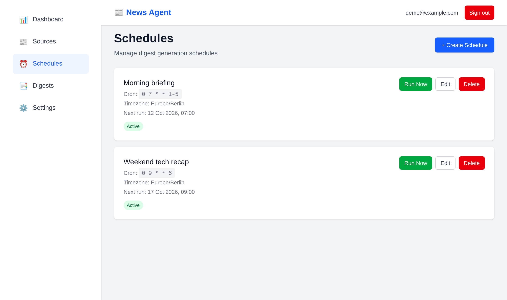
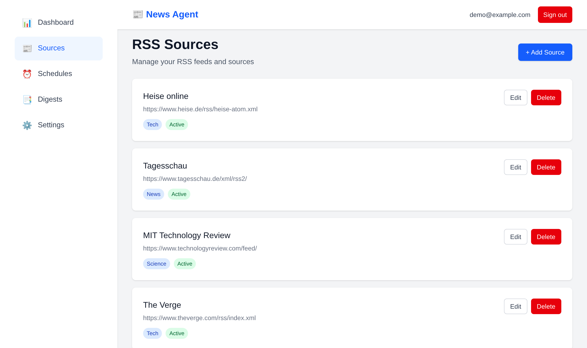
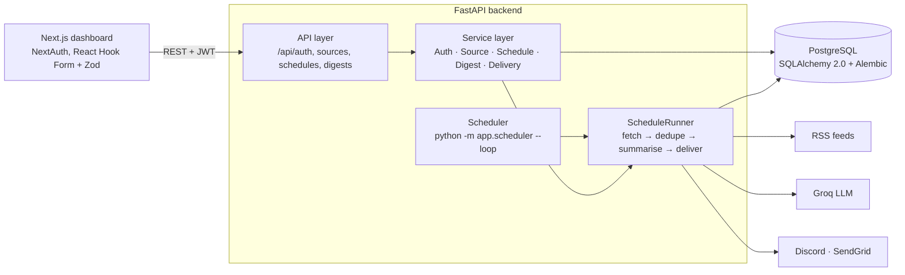

# News Agent

[](https://github.com/maxikrueger/news-agent/actions/workflows/ci.yml)


**Personalised AI news digests from your own RSS feeds, delivered on a schedule to Discord or e-mail.**

Users register, add the feeds they care about, describe their interests in a sentence
("AI regulation in the EU, robotics startups") and pick a cron schedule. At each run the
backend fetches the latest articles, removes duplicates, asks an LLM to select and summarise
the most relevant ones for that profile, stores the digest and sends it to the configured
channels.



<table>
  <tr>
    <td></td>
    <td></td>
  </tr>
  <tr>
    <td align="center"><sub>Schedules: cron + time zone, run on demand</sub></td>
    <td align="center"><sub>RSS sources, validated before saving</sub></td>
  </tr>
</table>

## Features

- **Multi-user** with isolated data: every query is scoped to the authenticated user
- **RSS source management** with live feed validation before saving
- **Cron schedules** per user (`0 7 * * 1-5`), interest profile and output language
- **LLM summarisation** via Groq (Llama 3.3 70B); falls back to a plain article list when the API is unavailable
- **Duplicate detection** across feeds (exact hash + word-overlap similarity)
- **Delivery** to Discord webhooks (auto-chunked to the 2000-char limit) and e-mail via SendGrid
- **Background scheduler** that runs due schedules; a broken schedule never blocks the others
- **Digest history** and "run now" from the dashboard

## Architecture



The API endpoint `POST /api/schedules/{id}/run` and the background scheduler share the same
`ScheduleRunner`, so a manual run and a scheduled run behave identically.
More detail in [docs/ARCHITECTURE.md](docs/ARCHITECTURE.md).

## Tech stack

| Layer | Technology |
|---|---|
| Backend | Python 3.12, FastAPI, SQLAlchemy 2.0 (typed `Mapped` models), Alembic, Pydantic v2 |
| Auth | JWT (python-jose), Argon2 password hashing, httpOnly cookie or Bearer header |
| Integrations | Groq via the OpenAI SDK, feedparser, croniter, SendGrid, Discord webhooks |
| Frontend | Next.js 16 (App Router), React 19, TypeScript, Tailwind CSS 4, NextAuth, React Hook Form, Zod |
| Quality | pytest (95 tests, ~83 % coverage), ruff, mypy, ESLint |
| Ops | Docker Compose, GitHub Actions (lint, types, tests, migrations against PostgreSQL) |

## Quick start (Docker)

```bash
git clone https://github.com/maxikrueger/news-agent.git
cd news-agent
cp .env.example .env          # set POSTGRES_PASSWORD, SECRET_KEY, NEXTAUTH_SECRET
docker compose up --build
```

- Dashboard: http://localhost:3000
- API docs (OpenAPI): http://localhost:8000/docs

`GROQ_API_KEY` and `SENDGRID_API_KEY` (plus a verified `SENDGRID_FROM_EMAIL`) are optional. Without them, digests are plain
article lists and the e-mail channel is unavailable; everything else works.

## Local development

**Backend** (needs a PostgreSQL database):

```bash
cd backend
python -m venv .venv && source .venv/bin/activate
pip install -e ".[dev]"
cp .env.example .env           # set DATABASE_URL and SECRET_KEY
alembic upgrade head
uvicorn app.main:app --reload  # API on :8000
python -m app.scheduler --loop # in a second terminal: runs due schedules
```

**Frontend:**

```bash
cd frontend
npm ci
cp .env.example .env.local     # set NEXTAUTH_SECRET
npm run dev                    # dashboard on :3000
```

## Quality checks

The same commands run in CI on every push:

```bash
cd backend
ruff check . && ruff format --check .
mypy app
pytest --cov=app
alembic check                  # ORM models match the migrated schema (needs DATABASE_URL)

cd ../frontend
npm run lint && npx tsc --noEmit && npm run build
```

## Design decisions

- **Fail loud on missing secrets.** `DATABASE_URL` and `SECRET_KEY` (≥ 32 chars, no placeholder)
  are required settings; the app refuses to start instead of falling back to insecure defaults.
- **Explicit CORS allow-list.** Credentialed requests are only accepted from `ALLOWED_ORIGINS`.
- **Service layer owns the use cases.** Routers validate input and map errors to HTTP;
  `ScheduleRunner` raises a domain error (`ScheduleRunError`) that the API turns into `400`
  and the scheduler logs and skips.
- **Graceful degradation.** LLM failures fall back to an extractive digest; one failing
  delivery channel does not stop the others.
- **Schema drift is a CI failure.** Models are checked against the Alembic migrations on a real
  PostgreSQL instance with `alembic check`.

## Responsible use

News Agent reads RSS/Atom feeds that publishers offer for syndication; it does not crawl or
scrape web pages. Per article it stores only the title, the short summary contained in the feed
and the link, never the full text, and every digest links back to the original source.

The project is intended for personal news digests. If you run it for others or commercially,
you are responsible for complying with the terms of use of the feeds you add and with the
applicable copyright and press-publisher rights.

## Known limitations

- No rate limiting on auth endpoints yet (planned: `slowapi`, 5 login attempts/min/IP).
- Password-reset and e-mail-verification tokens are implemented, but the e-mails that deliver them are not.
- The scheduler is a single polling process; running several replicas would need a row lock
  (`SELECT … FOR UPDATE SKIP LOCKED`) around due schedules.
- Frontend has no automated tests yet.

## Project structure

```
backend/
  app/
    api/v1/          REST endpoints (thin: validation, auth, error mapping)
    services/        use cases: auth, sources, schedules, digest, delivery, runner
    integrations/    Groq client
    db/              SQLAlchemy models and session handling
    schemas/         Pydantic request/response models
    scheduler.py     background runner for due schedules
  migrations/        Alembic migrations
  tests/             pytest suite (SQLite in-memory)
frontend/
  app/               Next.js App Router pages (auth, dashboard)
  components/        forms and cards
  lib/               API client, shared types, Zod schemas
docs/                architecture and deployment notes
```

## License

[MIT](LICENSE)
