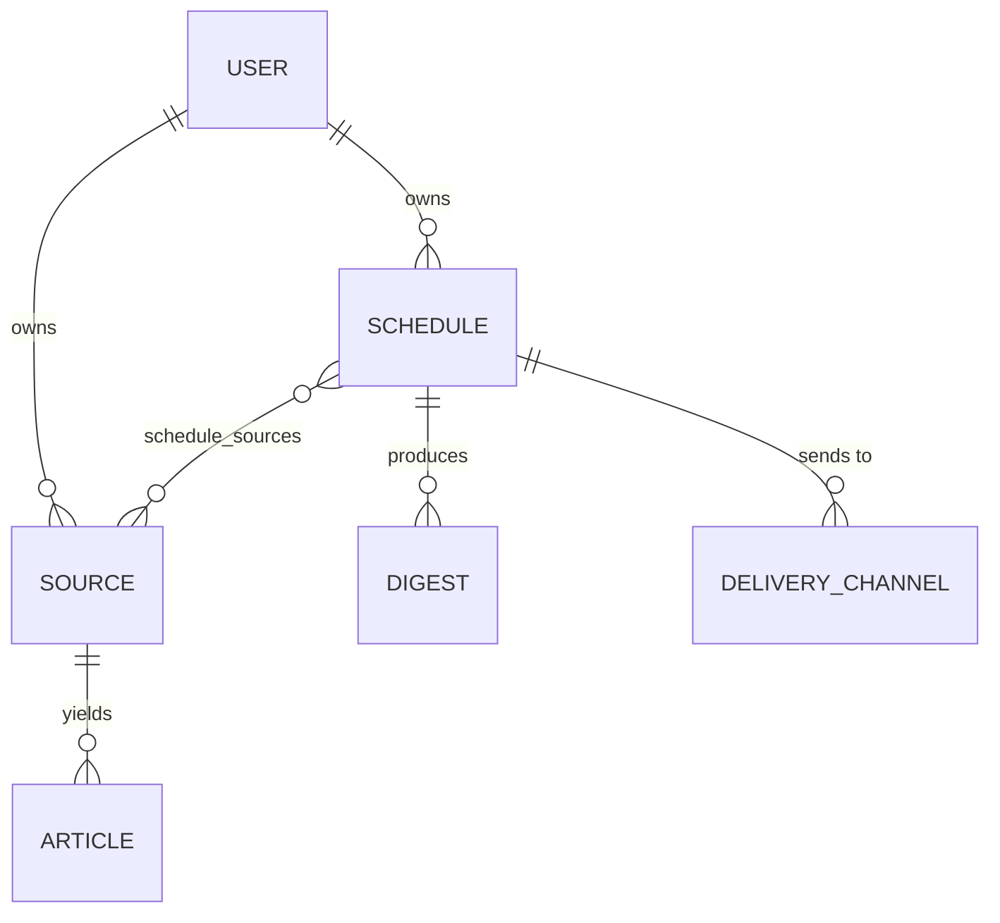

# Architecture

## Overview

News Agent is split into a Next.js dashboard and a FastAPI backend that share nothing but a
REST API. The backend has two entry points that run the same code: the HTTP API
(`uvicorn app.main:app`) and the background scheduler (`python -m app.scheduler`).

```
frontend (Next.js)  ──REST/JWT──▶  API layer  ──▶  service layer  ──▶  PostgreSQL
                                                    ▲
                    scheduler process  ─────────────┘
```

## Backend layers

| Layer | Location | Responsibility |
|---|---|---|
| API | `app/api/v1/` | Request validation (Pydantic), authentication dependency, mapping domain errors to HTTP status codes |
| Services | `app/services/` | Use cases and transactions: `AuthService`, `SourceService`, `ScheduleService`, `DigestService`, `DeliveryService`, `ScheduleRunner` |
| Integrations | `app/integrations/` | External APIs (Groq via the OpenAI-compatible endpoint, with retries) |
| Persistence | `app/db/` | SQLAlchemy 2.0 typed models, session factory; schema owned by Alembic migrations |

## Data model



- A **schedule** holds the cron expression, its time zone, the interest profile, the output
  language and `next_run_at` (stored in UTC).
- **Articles** are cached per source and de-duplicated by URL / feed entry id.
- **Delivery channels** store their configuration (webhook URL, e-mail address) as JSON.

## Running a schedule

`ScheduleRunner.run()` is the single implementation used by both the "run now" endpoint and
the scheduler:

1. Load the schedule's sources (no sources → `ScheduleRunError`).
2. Fetch entries from the last 24 hours; if none, widen the window to 7 days and prepend a
   notice to the digest (still none → `ScheduleRunError`).
3. Remove duplicates: exact hash of title + source, then word-overlap similarity > 0.7.
4. Ask the LLM to pick the `max_articles` most relevant items for the profile and summarise
   them in the requested language. If the API key is missing or the call fails, an extractive
   digest (titles, feed summaries, links) is produced instead.
5. Store the digest, advance `next_run_at`, then deliver to every enabled channel. Each channel
   reports `sent`, `failed` or `error: …` independently.

## Scheduler

`python -m app.scheduler --loop` polls every 60 seconds for active schedules whose
`next_run_at` has passed and runs them one by one. Cron expressions are evaluated in the
schedule's own time zone, so "07:00 Europe/Berlin" stays at 07:00 across daylight-saving
changes. A schedule that fails is logged and still advanced to its next slot, so it cannot
block other schedules or be retried every tick.

Without `--loop` the command processes due schedules once and exits, which suits an external
cron job or a PaaS cron trigger.

## Authentication

- Passwords are hashed with Argon2.
- Login returns a signed JWT (HS256, 30 min) both in the response body and as an httpOnly
  cookie (`Secure` + `SameSite=None` in production, `SameSite=Lax` locally).
- The API accepts the token as `Authorization: Bearer …` or via the cookie. The dashboard uses
  NextAuth's credentials provider and forwards the token as a Bearer header.
- Every query filters by the authenticated `user_id`; foreign IDs return `404`, not `403`,
  so the API does not reveal whether a resource exists.

## Configuration

Settings are read by `app/config.py` (pydantic-settings). `DATABASE_URL` and `SECRET_KEY`
are required and validated at import time: a missing value, a key shorter than 32 characters
or a placeholder like `changeme` stops the process before it serves a request.

## Testing

- `tests/` runs against an in-memory SQLite database with FastAPI's `TestClient`; external
  calls (feeds, Groq, Discord, SendGrid) are mocked.
- CI additionally applies all migrations to PostgreSQL 16, rolls them back, re-applies them and
  runs `alembic check` to fail on any difference between models and migrations.
